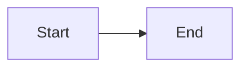

# ADR-002: Where node positions live

**Date:** 2026-10-31

## Context

See ADR-0001: the Mermaid text is the single source of truth and must stay clean, because it lives in git and is read and rewritten by AI. Mermaid has no concept of node positions, so positions set in the visual editor have to be stored somewhere else.

This ADR decides **where** positions are persisted. The exact file format is a detail and is only sketched here.

Requirements:

- **One file per diagram.** A diagram must never depend on a second file that can get lost, forgotten in a commit or not shared along.
- **Diagram and layout stay separated** inside that file, so the diagram part can be read, edited and rewritten without touching positions.
- The file stays valid Mermaid, so it still renders on GitHub and in docs.

Positions must survive:

- reopening the file, also after it was edited externally (VS Code, an AI tool)
- renaming a node's label
- an AI rewriting the whole code, as long as node IDs stay the same

Positions only matter inside Mirrormaid. GitHub and other Mermaid renderers use their own auto-layout and ignore any stored positions anyway.

## Options

0. **No stored positions**: always auto-layout, nodes can't be placed manually (baseline).
1. **Positions in the text**
   - **1a:** a comment line right after each node, e.g. `%% @pos A 120 80`. Mermaid comments have to be on their own line, so "behind the node" on the same line isn't possible.
   - **1b:** one plain comment block at the end of the file listing all positions, shown in the editor like any other code.
   - **1c:** like 1b, but the block has a reserved syntax and is **managed by Mirrormaid**: the code editor hides it, protects it from edits and keeps it at the end of the file. Users only see it when they open the file with another tool.
2. **Positions in a separate data structure**, keyed by node ID
   - **2a:** sidecar file next to the diagram, e.g. `flow.mmd` + `flow.layout.json`.
   - **2b:** container file holding both the Mermaid text and the layout, e.g. `flow.mirrormaid.json`.

## Evaluation

| #   | Scenario                               | 0 Auto | 1a Inline | 1b Block | 1c Hidden block | 2a Sidecar | 2b Container |
| --- | -------------------------------------- | ------ | --------- | -------- | --------------- | ---------- | ------------ |
| S1  | Move node in UI → git diff of `.mmd`   | ❌     | ❌        | ❌       | ⚠️              | ✅         | ⚠️           |
| S2  | Create node in UI                      | ❌     | ⚠️        | ⚠️       | ✅              | ✅         | ✅           |
| S3  | AI rewrites whole code, IDs kept       | ➖     | ❌        | ⚠️       | ✅ / ⚠️         | ✅         | ✅           |
| S4  | Rename node ID in code (`A` → `Start`) | ➖     | ⚠️        | ❌       | ❌              | ❌         | ❌           |
| S5  | Delete node                            | ➖     | ⚠️        | ⚠️       | ✅              | ✅         | ✅           |
| S6  | Copy code to GitHub / docs             | ✅     | ❌        | ⚠️       | ✅ / ⚠️         | ✅         | ❌           |
| S7  | File edited externally, then reopened  | ➖     | ✅        | ✅       | ✅              | ✅         | ⚠️           |
| S8  | Share a single file with someone       | ✅     | ✅        | ✅       | ✅              | ❌         | ✅           |

Creating a node via code is left out, because it works the same in every option: a new ID has no stored position, so it gets auto-placed.

S8 is now a hard requirement (one file per diagram), which rules out 2a regardless of its other scores.

### Notes

- **S1:** With 1a/1b every drag in the UI changes the `.mmd` file in places the user reads. With 1c the file changes too, but only inside the layout block at the end. If there is one line per node, sorted by ID and with rounded coordinates, moving a node is a one-line diff in a clearly marked section. That is a weaker form of "minimal diffs" from ADR-0001, but an acceptable one. With 2a only the JSON changes. With 2b the container file changes, but the Mermaid part stays the same.
- **S2:** Option 0 can't keep the position at all. 1a/1b have to insert an extra visible line into the code for every new node. 1c adds a line to the hidden block, so the user doesn't see any change in the code.
- **S3:** An AI usually drops or garbles comments it doesn't understand, especially inline ones (1a). With 1b it may keep the block, but there's no guarantee. With 1c there are two cases. If the user pastes the AI output into the Mirrormaid editor, the hidden block isn't part of the visible text and isn't replaced by the paste, so all positions survive (✅). If the AI edits the file directly, it sees the block and may drop it (⚠️). A marker line like "generated, do not edit" lowers that risk, and if the block is dropped anyway, the diagram falls back to auto-layout. With 2a/2b the AI never sees the positions.
- **S4:** Renaming an ID in the UI is fine in every option, because the app updates both the text and the positions. Renaming it in code is the weak spot. In 1a the comment line sits next to the node and can be matched by adjacency. In all other options the old ID no longer matches, so the node falls back to auto-layout. The rule could be made smarter later (match by label).
- **S5:** 1a/1b leave an orphaned comment line in the code if the user only deletes the node line. In 1c, 2a and 2b orphaned entries are invisible and get pruned on save.
- **S6:** 1a puts noise all over the code. 1b can be stripped but is still noise when copied as is. With 1c, copying from the Mirrormaid editor only copies the visible code (✅). Copying the raw file includes the block, but it's made of Mermaid comments, so it still renders correctly and is only visible in the source (⚠️). 2b isn't plain Mermaid at all and needs an export step.
- **S7:** With 2b an external editor or AI has to deal with JSON instead of plain Mermaid, which makes external editing awkward.
- **S8:** With 2a the sidecar can get lost or not be shared along. All other options keep everything in one file.

### Matching rule (for options 1b, 1c, 2a, 2b)

Positions are keyed by node ID. When the text is parsed, every node whose ID has a stored position keeps it, and every new ID gets auto-placed. Entries for IDs that no longer exist are removed on save. That's the whole logic, so no special detection for "re-added text" is needed.

## Decision

We go with **option 1c (hidden layout block)**, because it is the only option that keeps everything in one file (S8) while the diagram code the user sees and edits stays free of layout data (S2, S3, S6). We accept that moving a node still changes the `.mmd` file (S1), limited to one line in the layout block, that an AI editing the raw file directly may drop the block (S3), in which case the diagram falls back to auto-layout, and that renaming a node ID in code loses its position (S4).

Format sketch (always at the end of the file, one line per node, sorted by ID, integer coordinates):

## Consequences

- **Easier:**
  - One file per diagram, which is easy to share, move, rename and commit.
  - The file is still valid Mermaid and renders on GitHub and in docs, because the block is made of comments.
  - Inside Mirrormaid the user only ever sees clean diagram code.
  - The matching logic is simple: same ID means same position.
- **Harder:**
  - The code editor has to hide the block, make it read-only and keep it at the end of the file (e.g. with CodeMirror replace decorations, atomic ranges and a transaction filter).
  - The span-aware parser from ADR-0001 has to recognize the block as reserved and leave it out of the diagram model. UI patches must never touch it, and position updates must never touch the diagram part.
  - Copy, select-all, search and replace in the editor must behave as if the block doesn't exist.
  - A broken or manually edited block has to be handled gracefully (ignore invalid lines, fall back to auto-layout).
  - Moving nodes still shows up in git diffs, just in a clearly marked place.
- **Follow-up:**
  - Whether moving a node is part of the editor's undo stack (ADR-0001, S9) or has its own undo.
  - Node sizes and edge routes (bends, waypoints) could live in the same block. That needs its own decision.
  - A smarter matching for renamed IDs (e.g. by label) if S4 turns out to be annoying in practice.
  - An optional "export without layout" action for clean copies of the raw file.
