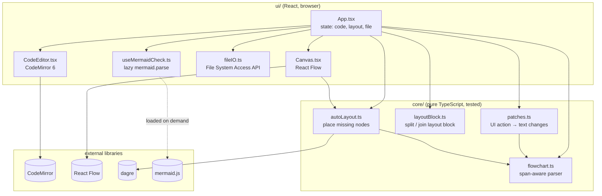
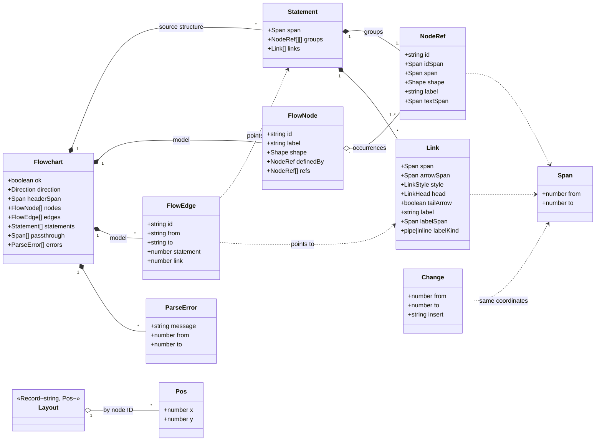

# Architecture

| #   | View                        | Diagram type  | Question                                  |
| --- | --------------------------- | ------------- | ----------------------------------------- |
| 1   | [Modules](#1-modules)       | Flowchart     | What parts exist and who depends on whom? |
| 2   | [Data model](#2-data-model) | Class diagram | What does the parser produce?             |

## 1. Modules

Two layers. `core/` is plain TypeScript without React, so it can be unit-tested and reused (e.g. in a VS Code extension later). `ui/` is React and owns all browser APIs. Dependencies only point from UI to core, never back.

`mermaid.js` is only used to check "would GitHub render this?". It doesn't draw anything, because Mermaid can't place nodes at fixed positions and its parser has no source spans (see ADR-001, ADR-002).

## 2. Data model

What `parseFlowchart(text)` returns. The key idea of ADR-001: every token remembers its `Span` (start/end offset in the text), so a UI edit can patch exactly that spot.

Two views of the same text:

- **Source structure** (`Statement`, `NodeRef`, `Link`) mirrors the code exactly as written, including chains (`A --> B --> C`) and groups (`A & B --> C`). Patches work on this.
- **Model** (`FlowNode`, `FlowEdge`) is what the canvas draws. A node written three times in the code is one `FlowNode` with three `refs`. The last ref with a shape wins, like in Mermaid.

`Layout` is not part of the parse result. It lives next to the code and is joined with it only on save (section 4).
